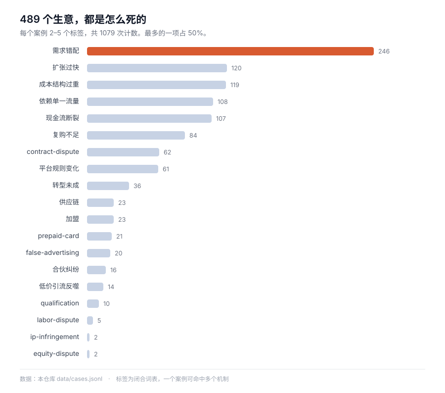

# Startup Case Atlas

[中文](README.md) · **English** · [日本語](README.ja.md) · [한국어](README.ko.md) · [Español](README.es.md)

    

**489 businesses, every one with the books kept: what it cost, what it earned, and the exact step where the money ran out.**

**246 of them (59%) died of the same thing** — building something nobody wanted, and spending the money finding that out.

**Plus 234 framework cards** — judgement tools extracted from 43 books and courses. Cases are evidence; frameworks are judgement.

[Browse by failure mechanism](index/by-mechanism.md) · [By industry](index/by-industry.md) · [By region](index/by-region.md) · [Get the data](data/cases.jsonl) · [Feed a model](llms.txt)



> **Case bodies are written in Chinese.** The schema, indexes, data files and this README are English; the 489 narratives are Chinese, because that is the gap this atlas fills — Chinese-language, structured, sourced business cases are scarce, while English ones are not.

---

## 30 seconds in

| What you want | Where to go |
| --- | --- |
| Read one | [`index/by-mechanism.md`](index/by-mechanism.md) — start with "franchise" or "cash-flow crunch" |
| A specific cut | [Industry](index/by-industry.md) · [Outcome](index/by-outcome.md) · [Region](index/by-region.md) · [Year](index/by-year.md) |
| The data | [`data/cases.jsonl`](data/cases.jsonl) — 489 lines, one case per line, all fields |
| An LLM | Read [`llms.txt`](llms.txt) (1.3 KB) first, then [`llms-full.txt`](llms-full.txt) (1.7 MB) if context allows |
| A judgement tool | [Browse frameworks by book](index/frameworks-by-book.md) — 234 cards from 43 books and courses |

```bash
git clone https://github.com/Shooang/startup-case-atlas.git
```

## What one case looks like

This one: a seafood buffet in Qingdao. The owner sold his house for 1.5M RMB, took in 600–700k RMB in the first month, and ended it 200k+ RMB in the hole. Closed in month four.

```yaml
id: G623
title: 卖房凑150万加盟火锅自助，首月流水70万反而亏20多万，四个月闭店
title_en: Sold his house for 1.5M RMB to join a buffet chain, closed in four months
type: 中文小生意
source: https://cbgc.scol.com.cn/news/7946483
era: 中文·青岛·2025-2026
region: CN
outcome: failure
industry: food-beverage
tags: [franchise, low-price-trap, cashflow-crunch, cost-structure]
key_numbers: 总投入150多万（加盟费十几万＋装修40多万＋备货七八十万）｜首月流水六七十万、净亏20多万｜59.9元引流套餐预售近80万｜4个月闭店、自称损失180多万
```

Every file has the same skeleton: **16 fixed fields + three body sections**.

- `## 故事正文` — 600–900 characters, chronological, no jumping to conclusions
- `## 可用观点` — what this case can be used to argue, grounded in mechanism
- `## 事实边界` — which numbers are the founder's own words, which are reporter interviews, which are estimates, which cannot be verified

That third section is deliberate. "Lost 700k" carries very different weight depending on whether it came from the founder, a journalist, or a court filing. Blending them is how bad analysis gets made.

## What's inside

| Directory | Cases | Coverage | Period |
| --- | --- | --- | --- |
| [`cases/01-personal-failure/`](cases/01-personal-failure/) | 4 | First-person failure accounts, written by the founders themselves | 2015–2024 |
| [`cases/02-founder-postmortems/`](cases/02-founder-postmortems/) | 25 | Long-form founder post-mortems, mostly B2B and developer tools | 2006–2016 |
| [`cases/03-failory/`](cases/03-failory/) | 129 | Founder interviews on failed startups across 20+ countries | 2020–2023 |
| [`cases/04-indie-hacker/`](cases/04-indie-hacker/) | 156 | Solo founders and small teams shipping paid products | 2019–2026 |
| [`cases/05-china-interviews/`](cases/05-china-interviews/) | 69 | Chinese physical businesses: restaurants, franchises, shops, services | 2018–2026 |
| [`cases/06-starter-story/`](cases/06-starter-story/) | 36 | Small businesses with revenue, startup cost and time-to-launch | 2019–2024 |
| [`cases/07-judgments/`](cases/07-judgments/) | 70 | Court judgments: franchise, splits, buyback bets, invoices, non-compete, trademark, nominee shares, prepaid cards, construction, used cars, renovation, livestreams, dispatch labour, medical beauty, pets, driving schools, matchmaking agencies, orthodontics, loan brokerage, personal training, maternity care, travel | 2016–2026 |
| [`legacy/articles/`](legacy/articles/) | 95 | Archived early Chinese web entrepreneurship stories, most original links dead | 2000–2012 |

**Totals:** 489 cases · ~686,000 characters of case text · 95 archived articles · 31 countries and regions · 13 industries · 5 outcome types · 19 failure mechanisms.

## Framework cards: the judgement layer

A case tells you how something happened. A framework tells you how to judge the next one. **234 cards, drawn from 43 books and courses.**

Each card opens with a line you can read aloud, explains what the framework actually says, gives three or four things you can judge with it, and ends with **sources and limits** — where the method stops working.

| Book / course | Cards | What you can judge with it |
| --- | --- | --- |
| Business Thinking Case Notes · Cao Xiongfeng | 32 | Four rulers of value creation, tear cost down to physical limits, displacement means taking what the incumbent abandoned |
| Winning · Jack Welch | 10 | The vitality curve's hard preconditions and costs, two ways budgets go wrong, seven acquisition traps |
| Lean Business Thinking · Cheng Hao | 10 | Real demand has three thresholds, validate in two days not two months, only three ways to acquire |
| The Long Tail · Chris Anderson | 9 | Long tails need three costs to fall together, 80/20 is usually misread, 98% of titles sell each quarter |
| The Hard Thing About Hard Things · Horowitz | 8 | Lay off once and completely, tell the whole bad news, only two questions decide whether to sell |
| Zero to One · Peter Thiel | 8 | Four features of monopoly, no secrets no zero-to-one, sales is not an appendage |
| The PayPal Wars · Eric Jackson | 8 | Subsidies buy network density, on someone else's platform they set the rules, fraud loss is a budget line |
| Harvard Business Review 2020 · twelve issues | 8 | Data is not a moat by default, undefined success gets defined by growth, three traps in A/B tests, discounting hands pricing power to the channel |
| Where Does Money Come From · Xiang Shuai | 7 | Careers snowball or push a rock, your city sets your income floor and ceiling |
| Learning Reviews from Masters · Zhang Peng | 7 | In a review, handle the fear before the argument; candor is institutional design; who sits in the room decides more than what you ask |
| The Psychology of Money · Housel | 6 | Luck looks like risk, compounding is invisible for decades, savings rate beats returns |
| Poor Charlie's Almanack · Munger | 6 | To the man with a hammer everything looks like a nail, invert, the edge of competence matters more than its size |
| Build · Fadell | 6 | Fail small enough to retry, a product starts as a story, data and opinion belong to different stages, hire slow and fire fast |
| A Dog Called Money · Schäfer | 5 | Feed the goose before chasing returns, the 72-hour rule, debt is not paid off with everything |
| Ten Years of Dollar-Cost Averaging · Bank Ticker | 5 | Averaging pays for buying cheap, the smile curve, write the exit rule first |
| The Almanack of Naval Ravikant · Naval | 5 | Specific knowledge, three kinds of leverage, never rent out your time, long games compound |
| The Logic of Housing Prices · Xu Yuan | 5 | A high price-to-income ratio is not a bubble, city before location before unit |
| The Intelligent Investor · Graham | 5 | Mr Market quotes moods not value, margin of safety, defensive versus enterprising |
| The Four · Galloway | 5 | In the T algorithm story is the only variable that reprices capital, Amazon trades profit for scale, Apple charges willingness to pay |
| ByteDance · Brennan | 5 | The algorithm replaced the editor's judgement, cold start means filling supply first, the moat is two-sided lock-in |
| The Secret of Silicon Valley · Wu Jun | 5 | Institutions decide whether talent can move, bankruptcy is a line on the next fundraise, predictable and unpredictable systems need different methods |
| Team of Teams · McChrystal | 5 | Predictive management fails in complex environments, silos are created by appraisal, empowerment moves decision rights, information and competence together |
| An Introduction to General Systems Thinking · Weinberg | 5 | Double the size and the computation quadruples, mechanism is fine until coupling is tight, where you cut decides what you can see |
| The Fifth Discipline · Senge | 5 | The five disciplines are one set, seven learning disabilities, draw the loop to find the leverage, vision as a stretched rubber band |
| Letters from Silicon Valley · Wu Jun | 5 | Saving people money and getting them to spend are two businesses, cut the options, misallocated cost kills companies, capital stack sets tolerance for error |
| Five-Minute Business School, Practicum · Liu Run | 5 | Not every product must earn money but each needs a role, paying for referrals kills them, commission is about the multiple |
| Rich Habits · Corley | 4 | Habits precede outcomes, the 77% versus 23% gap, change the trigger not the will |
| Earn Money Well · Jian Qi | 4 | Split income into four buckets, the emergency fund, insurance buys tail risk |
| What They Don't Teach You at Harvard Business School · McCormack | 4 | Find the buyer before naming the price, negotiation is about alternatives, free work buys a seat at the table |
| One Thousand and One Nights at NetEase · NetEase Hangzhou PMO | 4 | Keep only the process that can change a decision, when you lack authority the seat itself is authority, management changes with the product stage |
| The Intelligence Era · Wu Jun | 4 | Big data means the full set plus correlation, machines replace judgement that can be datified, revolutions hollow out the middle first, data ownership sits with whoever holds it |
| Profit from the Positive · Greenberg & Maymin | 3 | A meeting costs people times hours, a leader's mood is contagious, a review that changes nothing is worse than none |
| Committed Teams · Moussa, Boyer & Newberry | 3 | Rules come from dialogue not friction, remote teams pay in trust, startup culture forms anyway |
| Your First Leadership Job · Byham & Wellins | 3 | A leader is a catalyst not the hero, the five-step conversation map, people leave their direct leader |
| 33 Personal Finance Lessons Before 35 · Zeng Zhiyao | 3 | The order of payday, bookkeeping to cut the 20%, allocation before 30 buys options |
| Managing in the 21st Century · Drucker | 3 | Seven management assumptions expired, five certainties of strategy, share of disposable income |
| Free · Chris Anderson | 2 | Four subsidy structures, the 5% rule |
| Xiaomi Startup Notes · Lei Jun | 2 | The seven-word creed is about efficiency and trust, "able to do anything" means nothing to do |
| The New Leader's 100-Day Action Plan · Bradt et al. | 1 | In the first hundred days ask questions, not restructure |
| Be the Boss Everyone Wants to Work For · Gentry | 1 | Promotion first takes away your peer status |
| My Life as a Quant · Emanuel Derman | 1 | Financial models are thought experiments, not truths |
| Charlie Munger: The Complete Investor · Robert Hagstrom | 1 | Strategies decay as they succeed because crowding kills the edge |
| Street Smarts · Jim Rogers | 1 | The cure for high prices is high prices, not controls |

[By book](index/frameworks-by-book.md) · [By doctrine](index/frameworks-by-doctrine.md) · [All opening lines](index/frameworks-hooks.md) · [Card schema](docs/framework-schema.md)

Cases and frameworks are different tools: **cases are evidence, frameworks are judgement.** One card plus two matching cases is a full episode.

## What you can do with it

**Write something.** One case is one episode: the numbers exist, the turn exists, and the `angles` field already says who this is for. Filter by mechanism and you get ten comparable cases for a cross-section.

**Size up a business.** Want to know whether franchise hotpot actually makes money? There are samples from Qingdao, Chengdu and Kunshan. Want to know why tools for creators die? There are 129 failure interviews to compare against. The same mechanism recurring across industries is more useful than any single case.

**Feed a model.** Chinese business-case long-tail corpora are scarce, especially small businesses with actual books. The structure is machine-first: closed field vocabularies, traceable sources, self-contained files that survive chunking.

## Why this exists

Most startup writing is either a success story with the numbers removed, or a failure story with the cause reduced to "poor management". This atlas is an attempt to do the opposite: take 489 individual businesses, and record for each one **what it cost, what it earned, where the money actually went, and which decision broke it**.

Two things make this collection unusual:

**It includes businesses that usually go unrecorded.** A 10-square-metre rice-noodle shop. A street stall. A franchise hotpot restaurant that did 700,000 RMB in its first month and still lost 200,000. Chinese small-business economics are documented here at the level of individual rent and ingredient costs, not industry averages.

**It documents where the numbers come from.** If a figure is disputed, the dispute is written down alongside it.

## Schema

16 fields; full definitions in [`docs/schema.md`](docs/schema.md).

| Field | Type | Notes |
| --- | --- | --- |
| `id` | string | `G001`–`G736`; gaps are reserved ranges |
| `title` | string | Chinese title, factual, carries the key number |
| `title_en` | string | English title, 8–14 words |
| `type` | string | Source type: self-account, interview, report, database |
| `source` | url | Link to the original article or interview |
| `era` | string | `language·country·year`, as stated by the source |
| `source_language` | enum | `zh` \| `en` \| `unknown` |
| `region` | enum | Country code; unknown is `unknown` and **never guessed** |
| `year` | int | Year the story starts |
| `outcome` | enum | `failure` \| `success` \| `exit` \| `pivoted` \| `ongoing` |
| `industry` | enum | 13 values, see [`docs/taxonomy.md`](docs/taxonomy.md) |
| `tags` | list | 2–5 failure mechanisms from a closed 19-term vocabulary |
| `key_numbers` | string | The numbers that carry the story, separated by `｜` |
| `timeline` | string | Start → turn → outcome, one line each |
| `causal_chain` | string | One causal spine, not a list of reasons |
| `angles` | string | What this case can be used to argue |
| `status` | string | Editorial state, not part of the data |

## Sources and licensing

This is a **derivative work, not a mirror**. Nothing here is copy-pasted: each case is a Chinese rewrite based on previously published reporting, with the original link in the file.

- **Case bodies** (489): [CC BY-SA 4.0](LICENSE). Reuse and adapt with attribution; derivatives keep the same licence.
- **4 cases derived from [`byoungd/up`](https://github.com/byoungd/up)**: that project's text is **CC BY-NC 4.0**, so those 4 are **non-commercial**. See [`ATTRIBUTIONS.md`](ATTRIBUTIONS.md).
- **Archived articles** (`legacy/`): copyright remains with the original authors and publishers. Included for research and indexing under a notice-and-takedown policy. See [`DISCLAIMER.md`](DISCLAIMER.md).

Upstream licences are preserved verbatim in [`third-party/`](third-party/). Attribution, retrieval dates and exactly what was used are listed per source in [`ATTRIBUTIONS.md`](ATTRIBUTIONS.md).

**If you are a rights holder** and want something removed, open an issue tagged `takedown`. No argument, it goes.

## Contributing

**Corrections are worth more than additions.** If a number here contradicts its original source, that is a bug — report it with the link. See [`docs/contributing.md`](docs/contributing.md).

New cases are welcome, but must pass three gates: a working original link, at least two concrete numbers, and a failure mechanism specific enough that "mismanagement" doesn't cover it.

## A note

This is not investment advice, and it is not a ranking of who is smart. A case appearing here means the business was recorded, not judged. Some of these failures got most things right and simply ran out of time.

---

If this saved you a few days of digging, **a star is the most direct way to say so** — and it helps the next person looking for this kind of material find it.

*Maintained as a public dataset. A backlink is appreciated when you use it in research or a product, but not required.*
