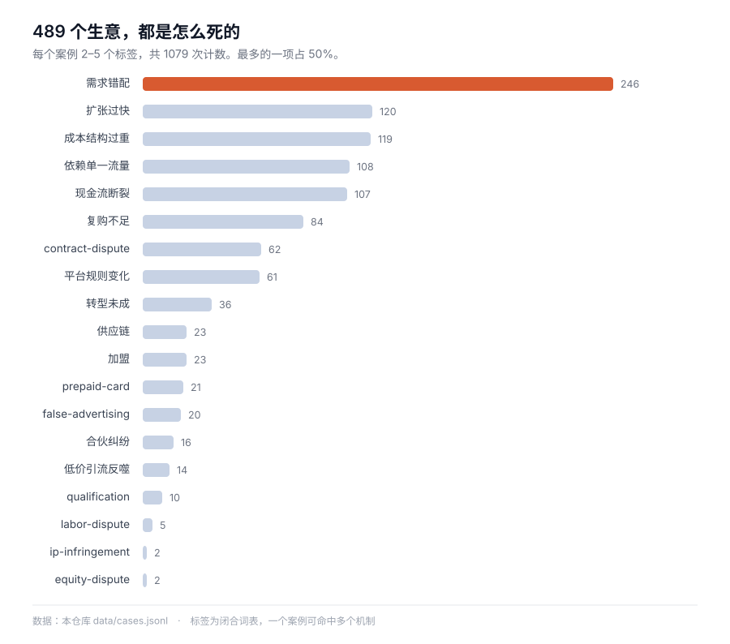

# Atlas de Casos de Emprendimiento

[中文](README.md) · [English](README.en.md) · [日本語](README.ja.md) · [한국어](README.ko.md) · **Español**

    

**499 negocios, cada uno con sus cuentas: cuánto costó, cuánto ingresó y en qué paso exacto se acabó el dinero.**

**246 de ellos (59 %) murieron de lo mismo**: construyeron algo que nadie quería y se gastaron el dinero averiguándolo.

[Explorar por mecanismo de fracaso](index/by-mechanism.md) · [Por sector](index/by-industry.md) · [Por región](index/by-region.md) · [Descargar los datos](data/cases.jsonl) · [Alimentar un modelo](llms.txt)



> **Los cuerpos de los casos están en chino.** El esquema, los índices, los datos y este README están en español; los 499 relatos están en chino, porque ese es el hueco que este atlas cubre: los casos de negocio estructurados y con fuentes en chino escasean, los que están en inglés no.

---

## En 30 segundos

| Lo que quieres | Dónde ir |
| --- | --- |
| Leer uno | [`index/by-mechanism.md`](index/by-mechanism.md): empieza por «trampa de franquicia» o «rotura de tesorería» |
| Un corte concreto | [Sector](index/by-industry.md) · [Desenlace](index/by-outcome.md) · [Región](index/by-region.md) · [Año](index/by-year.md) |
| Los datos | [`data/cases.jsonl`](data/cases.jsonl): 499 líneas, un caso por línea, todos los campos |
| Un modelo | Lee primero [`llms.txt`](llms.txt) (1,3 KB) y luego [`llms-full.txt`](llms-full.txt) (1,7 MB) si el contexto lo permite |

```bash
git clone https://github.com/Shooang/startup-case-atlas.git
```

Hay cinco índices. [Por sector](index/by-industry.md): hostelería, comercio, e-commerce, software, hardware, servicios. [Por desenlace](index/by-outcome.md): fracaso, venta, giro, en marcha. [Por mecanismo](index/by-mechanism.md): trampa de franquicia, rotura de tesorería, dependencia de plataforma, estructura de costes. [Por región](index/by-region.md): China, EE. UU., Reino Unido, India y 31 países en total. [Por año](index/by-year.md): cómo el mismo error se repite a lo largo de una década.

## Cómo es un caso

Un bufé de marisco en Qingdao. El dueño vendió su casa para reunir 1,5 millones de RMB; el primer mes facturó entre 600 y 700 mil RMB y al cierre contable perdió más de 200 mil. Cerró al cuarto mes.

```yaml
id: G623
title: 卖房凑150万加盟火锅自助，首月流水70万反而亏20多万，四个月闭店
title_en: Sold his house for 1.5M RMB to join a buffet chain, closed in four months
type: 中文小生意
source: https://cbgc.scol.com.cn/news/7946483
era: 中文·青岛·2025-2026
region: CN
outcome: failure
industry: food-beverage
tags: [franchise, low-price-trap, cashflow-crunch, cost-structure]
key_numbers: 总投入150多万（加盟费十几万＋装修40多万＋备货七八十万）｜首月流水六七十万、净亏20多万｜59.9元引流套餐预售近80万｜4个月闭店、自称损失180多万
```

Todos los archivos comparten el mismo esqueleto: **16 campos fijos + tres secciones de cuerpo**.

- `## 故事正文`: de 600 a 900 caracteres, en orden cronológico, sin saltar a la conclusión
- `## 可用观点`: para qué sirve este caso como argumento, bajado a mecanismo
- `## 事实边界`: qué cifras son palabras del propio fundador, cuáles son entrevista periodística, cuáles son estimaciones y cuáles no se pudieron verificar

La tercera sección es deliberada. El mismo «perdió 700 mil» pesa muy distinto según venga del fundador, de un periodista o de un expediente judicial. Mezclarlos es como se produce un análisis malo.

## Qué contiene

| Directorio | Casos | Cobertura | Periodo |
| --- | --- | --- | --- |
| [`cases/01-personal-failure/`](cases/01-personal-failure/) | 4 | Autopsias escritas por el propio protagonista | 2015–2024 |
| [`cases/02-founder-postmortems/`](cases/02-founder-postmortems/) | 25 | Reflexiones largas de fundadores, sobre todo B2B y herramientas | 2006–2016 |
| [`cases/03-failory/`](cases/03-failory/) | 129 | Entrevistas a startups fracasadas de más de veinte países | 2020–2023 |
| [`cases/04-indie-hacker/`](cases/04-indie-hacker/) | 156 | Productos de pago hechos por una persona o un equipo mínimo | 2019–2026 |
| [`cases/05-china-interviews/`](cases/05-china-interviews/) | 69 | Negocio físico en China: restauración, franquicias, tiendas, servicios | 2018–2026 |
| [`cases/06-starter-story/`](cases/06-starter-story/) | 36 | Pequeños negocios con ingresos, coste inicial y tiempo de arranque | 2019–2024 |
| [`cases/07-judgments/`](cases/07-judgments/) | 80 | Sentencias: franquicias, disoluciones, recompras, facturas, no competencia, marcas, acciones nominales, prepago, obra, coches usados, reformas, directos, trabajo temporal, estética médica, mascotas, autoescuelas, agencias matrimoniales, ortodoncia, intermediación de préstamos, entrenamiento personal, cuidado materno, viajes, tratamiento veterinario, guardería de mascotas, formaldehído en alquiler, materiales de reforma, inspección de vehículos, cobro ilegal de deudas, intermediación doméstica | 2016–2026 |
| [`legacy/articles/`](legacy/articles/) | 95 | Archivo de artículos chinos antiguos, en su mayoría con enlaces muertos | 2000–2012 |

**Totales:** 499 casos · unos 706 000 caracteres de relato · 95 artículos archivados · 31 países y regiones · 13 sectores · 5 desenlaces · 19 mecanismos de fracaso.

## Fichas de marco: la capa de juicio

Un caso te dice cómo pasó algo; un marco te dice cómo juzgar lo siguiente. **234 fichas, extraídas de 43 libros y cursos.**

Cada ficha abre con una frase que se puede leer en voz alta, explica qué dice el marco, da tres o cuatro cosas que puedes juzgar con él y termina con **fuentes y límites**: dónde deja de funcionar el método. Los cuerpos de las fichas están en chino; el campo `book` del índice mantiene el título original.

| Libro / curso | Fichas | Qué puedes juzgar |
| --- | --- | --- |
| 商业思维案例笔记 (notas de casos) · Cao Xiongfeng | 32 | Cuatro reglas de la creación de valor, desmontar el coste hasta el límite físico, desplazarse es ocupar el tramo que el incumbente soltó |
| Winning · Jack Welch | 10 | La curva de vitalidad exige precondiciones y cobra un precio, dos maneras de arruinar un presupuesto, siete trampas de adquisición |
| 精益商业思维 (mentalidad lean) · Cheng Hao | 10 | La demanda real tiene tres umbrales altos, validar en dos días y no en dos meses, solo tres vías de captación |
| La larga cola · Chris Anderson | 9 | La cola larga exige que tres costes caigan a la vez, el 80/20 suele leerse al revés, el 98 % de los productos se vende cada trimestre |
| The Hard Thing About Hard Things · Horowitz | 8 | Despedir de una sola vez y del todo, contar toda la mala noticia, vender o no se decide con dos preguntas |
| De cero a uno · Peter Thiel | 8 | Cuatro rasgos del monopolio, sin secretos no hay cero a uno, las ventas no son un apéndice |
| The PayPal Wars · Eric Jackson | 8 | Las subvenciones compran densidad de red, en plataforma ajena las reglas las cambia el dueño, el fraude es una partida presupuestada de I+D |
| Harvard Business Review 2020 · doce números | 8 | Los datos no son foso por defecto, el éxito sin definición lo define el crecimiento, tres trampas del test A/B, descontar es entregar el precio al canal |
| 钱从哪里来 (¿de dónde viene el dinero?) · Xiang Shuai | 7 | Las carreras o hacen bola de nieve o empujan piedra, la ciudad fija el suelo y el techo de tus ingresos |
| 跟着高手学复盘 (aprender revisiones de los maestros) · Zhang Peng | 7 | En una revisión, atiende primero el miedo; la franqueza es diseño institucional; quién está en la sala pesa más que qué se pregunta |
| La psicología del dinero · Housel | 6 | La suerte tiene la misma forma que el riesgo, el interés compuesto lleva décadas invisible, la tasa de ahorro manda sobre la de rentabilidad |
| Poor Charlie's Almanack · Munger | 6 | Con solo un martillo todo parece clavo, piensa al revés, el borde del círculo de competencia importa más que su tamaño |
| Build · Fadell | 6 | Fracasa en tamaño reintentable, un producto empieza siendo una historia, datos y opiniones pertenecen a etapas distintas, contrata despacio y despide rápido |
| Un perro llamado Dinero (小狗钱钱) · Schäfer | 5 | Alimenta la oca antes de perseguir rentabilidades, la regla de las 72 horas, la deuda no se paga volcando todo lo que tienes |
| 定投十年财务自由 (diez años de inversión periódica) · 银行螺丝钉 | 5 | La aportación periódica gana comprando barato, el tramo bajista de la curva sonriente, la regla de venta se escribe antes |
| El almanaque de Naval Ravikant · Naval | 5 | Conocimiento propio, tres clases de apalancamiento, no alquiles tu tiempo, solo los juegos largos componen |
| 房价的逻辑 (la lógica del precio de la vivienda) · Xu Yuan | 5 | Un ratio precio/ingresos alto no es burbuja, primero ciudad, luego barrio, por último piso |
| El inversor inteligente · Graham | 5 | El señor Mercado cotiza estados de ánimo, margen de seguridad, defensivo contra emprendedor |
| The Four · Galloway | 5 | En el algoritmo T solo la historia reprecia el capital, Amazon cambia beneficio por escala, Apple cobra disposición a pagar |
| Attention Factory (字节跳动) · Brennan | 5 | El algoritmo sustituyó el criterio del editor, el arranque en frío es llenar primero la oferta, el foso es el bloqueo de dos caras |
| 硅谷之谜 (el enigma de Silicon Valley) · Wu Jun | 5 | Las instituciones deciden si el talento circula, la quiebra es una línea del currículum en la próxima ronda, lo predecible y lo impredecible piden métodos distintos |
| Team of Teams · McChrystal | 5 | La gestión predictiva falla en lo intrincado, los silos los crea la evaluación, el empoderamiento baja decisión, información y capacidad a la vez |
| Introducción al pensamiento general de sistemas · Weinberg | 5 | Al doble de tamaño, el cuádruple de cómputo, el mecanicismo aguanta hasta que el acoplamiento aprieta, dónde cortas decide qué ves |
| La quinta disciplina · Senge | 5 | Las cinco disciplinas son un solo kit, siete discapacidades de aprendizaje, dibuja el bucle para hallar la palanca, la visión es una tensión estirada |
| Cartas desde Silicon Valley (吴军硅谷来信) · Wu Jun | 5 | Ahorrarle dinero a la gente y hacerle gastar son dos negocios, recorta opciones, el coste mal colocado mata el proyecto, la pila de capital fija la tolerancia al error |
| Escuela de negocio de cinco minutos, práctica (刘润5分钟商学院实战篇) · Liu Run | 5 | No todo producto tiene que ganar dinero pero sí tener un papel, pagar por referidos los mata, la comisión fija un múltiplo percibido |
| Hábitos de riqueza (富有的习惯) · Corley | 4 | Los hábitos preceden a los resultados, el hueco del 77 % contra el 23 %, cambia el disparador, no la voluntad |
| 好好赚钱 (gana bien tu dinero) · Jian Qi | 4 | Divide la renta en cuatro, el fondo de emergencia evita vender en el peor momento, el seguro compra el riesgo extremo |
| Lo que no te enseñan en Harvard Business School · McCormack | 4 | Confirma al comprador antes del precio, negociar es comparar alternativas, el trabajo gratis compra un asiento |
| Las mil y una noches de NetEase (网易一千零一夜) · PMO de NetEase Hangzhou | 4 | Guarda solo el proceso que cambia una decisión, sin autoridad el puesto ya es poder, la gestión cambia con la etapa del producto |
| La era de la inteligencia (智能时代) · Wu Jun | 4 | El umbral del big data es el conjunto completo y la correlación, la máquina sustituye el juicio datificable, la revolución vacía primero la capa media, los datos son de quien los retiene |
| Profit from the Positive (这样带出高估值团队) · Greenberg & Maymin | 3 | Una reunión cuesta personas por horas, el ánimo del líder se contagia, una evaluación que no cambia conducta es peor que ninguna |
| Committed Teams (三步打造高绩效团队) · Moussa, Boyer y Newberry | 3 | Las reglas salen del diálogo, los equipos remotos pagan en confianza, la cultura del startup brota sola |
| Your First Leadership Job (领导力的精进) · Byham y Wellins | 3 | El líder es un catalizador, el mapa de conversación en cinco pasos, la gente se va por su jefe directo |
| 33 lecciones de finanzas antes de los 35 (35岁前要上的33堂理财课) · Zeng Zhiyao | 3 | El orden del día de pago, la contabilidad para recortar ese 20 %, la asignación antes de los 30 compra opciones |
| Los desafíos de la gestión en el siglo XXI · Drucker | 3 | Siete supuestos viejos caducaron, cinco certezas de la estrategia, la proporción de renta disponible |
| Free · Chris Anderson | 2 | Cuatro estructuras de subsidio, la regla del 5 % |
| Apuntes de creación de Xiaomi · Lei Jun | 2 | El credo de siete palabras va de eficiencia y confianza, «poder con todo» es no saber qué hacer |
| El plan de 100 días del nuevo líder · Bradt et al. | 1 | Los primeros cien días son para preguntar, no para reorganizar |
| Sé el jefe por el que todos quieren trabajar · Gentry | 1 | El ascenso te quita primero la condición de par |
| My Life as a Quant (宽客人生) · Emanuel Derman | 1 | Los modelos financieros son experimentos mentales, no verdades |
| Charlie Munger: The Complete Investor (查理·芒格的智慧) · Robert Hagstrom | 1 | Las estrategias mueren de éxito cuando el hacinamiento mata la ventaja |
| Street Smarts (街头智慧) · Jim Rogers | 1 | La cura de los precios altos son los precios altos, no los controles |

[Por libro](index/frameworks-by-book.md) · [Por disciplina](index/frameworks-by-doctrine.md) · [Todas las aperturas](index/frameworks-hooks.md) · [Esquema de la ficha](docs/framework-schema.md)

## Para qué sirve

**Para escribir.** Un caso es el esqueleto de un capítulo: los números ya están, los giros ya están, y a quién mostrárselo está en `angles`. Filtra por mecanismo y tendrás diez casos del mismo tipo para comparar en paralelo.

**Para juzgar un negocio.** Si quieres saber si una franquicia de olla caliente es rentable, aquí hay muestras de Qingdao, Chengdu y Kunshan. Si quieres saber por qué las herramientas para creadores mueren tan fácilmente, hay 129 entrevistas de fracaso para contrastar. El mismo mecanismo reaparece en sectores distintos: esa regularidad vale más que un caso suelto.

**Para alimentar una IA.** El corpus en chino de casos de negocio tiene una cola larguísima casi vacía, sobre todo en negocios pequeños con cuentas concretas. Esta biblioteca está hecha para máquinas: campos cerrados, fuentes rastreables, cada archivo autocontenido. Troceado, cualquier fragmento sigue teniendo sentido.

## Por qué existe

Casi todo lo que se escribe sobre emprendimiento tiene dos defectos: las historias de éxito borran los números y las de fracaso reducen la causa a «mala gestión».

Este atlas intenta lo contrario. Toma 499 negocios concretos y registra, uno por uno, **cuánto costó, cuánto ingresó, a dónde se fue el dinero y en qué decisión se rompió**.

Dos cosas lo diferencian.

**Incluye los negocios que normalmente nadie registra.** Un local de fideos de diez metros cuadrados, un puesto callejero, una franquicia de olla caliente que facturó 700 mil RMB el primer mes y perdió más de 200 mil. La economía del pequeño comercio chino queda anotada al nivel del alquiler y del precio de compra, no en promedios sectoriales.

**Cada cifra lleva su procedencia.** Donde hay disputa, la disputa también está escrita.

## Esquema

Los 16 campos están definidos en [`docs/schema.md`](docs/schema.md). Resumen:

| Campo | Tipo | Descripción |
| --- | --- | --- |
| `id` | string | `G001`–`G736`; los huecos son tramos reservados |
| `title` | string | Título original en chino, con el dato clave |
| `title_en` | string | Título en inglés, de 8 a 14 palabras |
| `type` | string | Tipo de fuente: testimonio, entrevista, reportaje, base de datos |
| `source` | url | Enlace al original o a la entrevista de origen |
| `era` | string | `idioma·país·año`, según lo indique la fuente |
| `source_language` | enum | `zh` \| `en` \| `unknown` |
| `region` | enum | Código de país; si se desconoce, `unknown`, **nunca se adivina** |
| `year` | int | Año en que arranca el caso |
| `outcome` | enum | `failure` \| `success` \| `exit` \| `pivoted` \| `ongoing` |
| `industry` | enum | 13 valores, ver [`docs/taxonomy.md`](docs/taxonomy.md) |
| `tags` | list | De 2 a 5 mecanismos, de un vocabulario cerrado de 19 |
| `key_numbers` | string | Las cifras que sostienen el relato, separadas por `｜` |
| `timeline` | string | Origen → giro → desenlace, una frase cada uno |
| `causal_chain` | string | Una sola línea causal, no una lista de motivos |
| `angles` | string | Para qué se puede usar este caso como argumento |
| `status` | string | Estado editorial; no forma parte de los datos |

## Fuentes y licencia

Esto es una **obra derivada, no un espejo**. No hay ni un solo texto copiado y pegado: cada caso es un relato en chino escrito de nuevo a partir de material publicado, y el enlace al original está dentro del archivo.

- **Cuerpos de los casos** (499): [CC BY-SA 4.0](LICENSE). Se pueden reproducir y adaptar con atribución, y las obras derivadas mantienen la misma licencia.
- **4 de ellos provienen de [`byoungd/up`](https://github.com/byoungd/up)**: el texto de ese proyecto es **CC BY-NC 4.0**, así que esos 4 casos **no admiten uso comercial**. Ver [`ATTRIBUTIONS.md`](ATTRIBUTIONS.md).
- **Artículos archivados** (`legacy/`): los derechos son de sus autores y publicadores originales. Se incluyen solo con fines de estudio e indexación, bajo un mecanismo de notificación y retirada. Ver [`DISCLAIMER.md`](DISCLAIMER.md).

Las licencias de origen se conservan tal cual en [`third-party/`](third-party/). El crédito de cada fuente, la fecha de recogida y qué se usó están en [`ATTRIBUTIONS.md`](ATTRIBUTIONS.md).

**Si eres titular de derechos** y quieres que algo se retire, abre un issue con la etiqueta `takedown`. No discutimos: lo borramos.

## Contribuir

**Corregir vale más que añadir.** Si una cifra de aquí contradice la fuente original, es un bug: repórtalo con el enlace. Ver [`docs/contributing.md`](docs/contributing.md).

Se aceptan casos nuevos si pasan tres condiciones: un enlace original que abra, al menos dos cifras concretas y un mecanismo de fracaso más específico que «mala gestión». Lo que no tiene fuente y se escribió por suposición se rechaza, por buena que sea la historia.

## Una nota

Esto no es asesoramiento de inversión ni un ranking de quién es más listo. Que un caso aparezca aquí significa que fue registrado, no que fue juzgado. Algunos de los que fracasaron hicieron casi todo bien y simplemente no llegaron a tiempo.

---

Si esta biblioteca te ahorró unos días de búsqueda, **una estrella es la forma más directa de devolverlo**, y además hace que la próxima persona que busque este material llegue aquí más fácil.

*Se mantiene como conjunto de datos público. Si lo usas en investigación o en un producto, un enlace de vuelta se agradece, pero no es obligatorio.*
