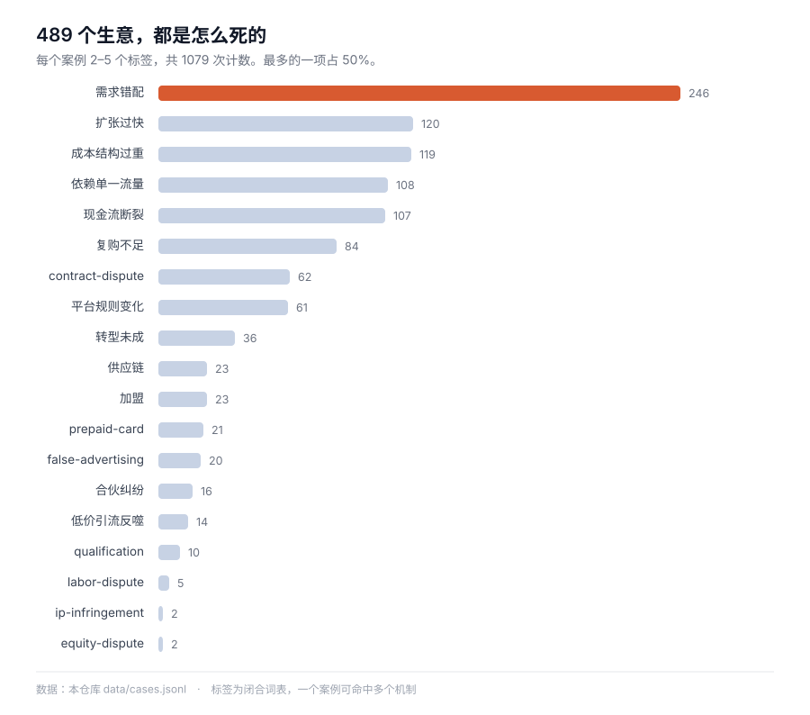

# スタートアップ事例アトラス

[中文](README.md) · [English](README.en.md) · **日本語** · [한국어](README.ko.md) · [Español](README.es.md)

    

**433 の事業、すべてに帳簿がついている。いくらかけて、いくら売れて、どの一手で金が尽きたのか。**

そのうち **246 件（59%）は同じ原因で死んでいる**——誰も欲しがらないものを作り、それが誰も欲しがらないと分かるために金を使い切った。

[失敗メカニズム別に見る](index/by-mechanism.md) · [業種別](index/by-industry.md) · [地域別](index/by-region.md) · [データを取る](data/cases.jsonl) · [モデルに読ませる](llms.txt)



> **ケース本文は中国語です。** スキーマ・索引・データファイル・この README は日本語ですが、433 本の本文は中国語で書かれています。構造化された中国語の事業ケースは希少で、そこがこのアトラスが埋めている穴だからです。

---

## 30 秒でつかむ

| 目的 | 行き先 |
| --- | --- |
| とりあえず一件読む | [`index/by-mechanism.md`](index/by-mechanism.md)——「フランチャイズの罠」か「資金繰り破綻」から |
| 特定の切り口で探す | [業種](index/by-industry.md) · [結末](index/by-outcome.md) · [地域](index/by-region.md) · [年](index/by-year.md) |
| データが欲しい | [`data/cases.jsonl`](data/cases.jsonl)——433 行、1 行 1 事例、全フィールド |
| モデルに読ませる | まず [`llms.txt`](llms.txt)（1.3 KB）、コンテキストが足りれば [`llms-full.txt`](llms-full.txt)（1.7 MB） |

```bash
git clone https://github.com/Shooang/startup-case-atlas.git
```

索引は五つあります。[業種別](index/by-industry.md) は飲食・小売・EC・ソフトウェア・ハードウェア・サービス。[結末別](index/by-outcome.md) は失敗・売却・転換・継続中。[失敗メカニズム別](index/by-mechanism.md) はフランチャイズの罠・資金繰り破綻・プラットフォーム依存・コスト構造。[地域別](index/by-region.md) は中国・米国・英国・インドほか 31。[年別](index/by-year.md) は同じ誤りが十年でどう繰り返されたか。

## ケース一件の中身

青島の海鮮ビュッフェ。オーナーは家を売って 150 万元を用意し、初月の売上は 60〜70 万元、月末に計算すると 20 万元以上の赤字。4 か月目で閉店した。

```yaml
id: G623
title: 卖房凑150万加盟火锅自助，首月流水70万反而亏20多万，四个月闭店
title_en: Sold his house for 1.5M RMB to join a buffet chain, closed in four months
type: 中文小生意
source: https://cbgc.scol.com.cn/news/7946483
era: 中文·青岛·2025-2026
region: CN
outcome: failure
industry: food-beverage
tags: [franchise, low-price-trap, cashflow-crunch, cost-structure]
key_numbers: 总投入150多万（加盟费十几万＋装修40多万＋备货七八十万）｜首月流水六七十万、净亏20多万｜59.9元引流套餐预售近80万｜4个月闭店、自称损失180多万
```

どのファイルも同じ骨格です。**16 の固定フィールド＋本文三節。**

- `## 故事正文`——600〜900 字。時系列で進み、結論を先に置かない
- `## 可用观点`——この事例で何を論証できるか。メカニズムのレベルまで落とす
- `## 事实边界`——どの数字が本人の証言で、どれが記者の取材で、どれが推定で、何が検証できなかったのか

三節目は意図的に置いています。同じ「70 万元の赤字」でも、本人が言ったのか、記者が書いたのか、裁判所が認定したのかで重さは全く違う。混ぜて語るのは不誠実です。

## 収録内容

| ディレクトリ | 件数 | 内容 | 時期 |
| --- | --- | --- | --- |
| [`cases/01-personal-failure/`](cases/01-personal-failure/) | 4 | 当事者自身が書いた失敗の記録 | 2015–2024 |
| [`cases/02-founder-postmortems/`](cases/02-founder-postmortems/) | 25 | 創業者による長文の振り返り（B2B・開発ツール中心） | 2006–2016 |
| [`cases/03-failory/`](cases/03-failory/) | 129 | 20 か国以上の失敗スタートアップへのインタビュー | 2020–2023 |
| [`cases/04-indie-hacker/`](cases/04-indie-hacker/) | 156 | 個人・少人数チームによる有料プロダクト | 2019–2026 |
| [`cases/05-china-interviews/`](cases/05-china-interviews/) | 69 | 中国の実業：飲食、フランチャイズ、小店、サービス | 2018–2026 |
| [`cases/06-starter-story/`](cases/06-starter-story/) | 36 | 月収・初期費用・立ち上げ期間つきの小規模事業 | 2019–2024 |
| [`cases/07-judgments/`](cases/07-judgments/) | 14 | 裁判と事例庫登載事例：加盟・散伙・対賭・未払代金の紛争 | 2016–2026 |
| [`legacy/articles/`](legacy/articles/) | 95 | 初期の中国語ウェブ記事アーカイブ（リンク切れ多数） | 2000–2012 |

**合計：** 433 ケース · 本文約 59.2 万文字 · アーカイブ 95 本 · 31 の国と地域 · 13 業種 · 5 つの結末 · 15 の失敗メカニズム。

## フレームカード：事例の背後にある判断道具

事例は「何が起きたか」を教え、フレームは「次に同じことが起きたらどう判断するか」を教えます。**234 枚、43 冊の書籍と講座から。**

各カードは、そのまま読み上げられる書き出し、フレームの中身、これで何を判断できるか 3〜4 条、最後に**出典と限界**——この方法が効かなくなる条件——で構成されています。カード本文は中国語で、書名は索引の `book` フィールド（中国語表記）と突き合わせて検索できます。

| 書籍・講座 | 枚数 | これで判断できること |
| --- | --- | --- |
| 商业思维案例笔记（ビジネス思考の事例ノート）· 曹雄峰 | 32 | 価値創造の四つの物差し、コストは物理的極限まで分解する、「ずらす」とは相手が手放した一段を引き受けること |
| ウィニング · ジャック・ウェルチ | 10 | 活力曲線には厳しい前提と代償がある、予算の二つの間違い、買収の七つの罠 |
| リーン・ビジネス思考（精益商业思维）· 程浩 | 10 | 本物の需要には三つの高いハードル、二日で検証できることを二か月かけない、集客の道は三つしかない |
| ロングテールの法則 · クリス・アンダーソン | 9 | ロングテール成立には三つのコストが同時に下がる必要、8:2 の法則はたいてい逆に読まれる、98% の商品は毎季誰かが買う |
| ハードシング · ベン・ホロウィッツ | 8 | 人員削減は一度で完全に、悪い知らせは全部話す、会社を売るかは二つの質問だけで決まる |
| ZERO to ONE · ピーター・ティール | 8 | 独占の四つの特徴、秘密がなければゼロからイチはない、販売は付属品ではない |
| ペイパル・ウォーズ · エリック・ジャクソン | 8 | 補助金が買うのはネットワークの密度、他人のプラットフォームでは他人がルールを変える、詐欺損失は予算に組み込んだ研究費 |
| ハーバード・ビジネス・レビュー 2020 年 12 号 | 8 | データは自動的には堀にならない、成功の定義を書かなければ成長が定義する、A/B テストの三つの罠、値引きは価格決定権をチャネルに渡す |
| 钱从哪里来（お金はどこから来るか）· 香帥 | 7 | キャリアは雪玉型と岩押し型に分かれる、都市が収入の下限と上限を決める |
| 跟着高手学复盘（達人のふりかえりに学ぶ）· 張鵬 | 7 | ふりかえりで揉めたらまず恐怖を受け止める、率直さは制度設計の産物、誰を部屋に呼ぶかが何を聞くかより結果を決める |
| お金の心理学 · モーガン・ハウゼル | 6 | 運はリスクと同じ形をして現れる、複利は数十年見えない、貯蓄率は利回りより自分で決められる |
| Poor Charlie's Almanack · チャーリー・マンガー | 6 | ハンマーしか持たない人にはすべてが釘に見える、逆から考える、能力圏の縁の位置が広さより重要 |
| BUILD · トニー・ファデル | 6 | 失敗はやり直せる大きさに収める、製品はまず一つの物語として語れること、データと意見は段階を分ける、採用は遅く解雇は速く |
| マネーという名の犬 · ボードー・シェーファー | 5 | 利回りの前にガチョウを育てる、72 時間ルール、借金は手持ちのすべてを注いで返すものではない |
| 定投十年财务自由（つみたて十年で経済的自由）· 银行螺丝钉 | 5 | つみたてが稼ぐのは「安く買えた」こと、スマイルカーブの下落区間、利益確定のルールは先に固定する |
| The Almanack of Naval Ravikant · ナヴァル・ラヴィカント | 5 | 固有の専門性、三種のレバレッジ、時間を貸し出さない、複利が効くのは長いゲームだけ |
| 房价的逻辑（住宅価格の論理）· 徐遠 | 5 | 価格所得比が高いだけではバブルではない、都市→立地→物件の順 |
| 賢明なる投資家 · ベンジャミン・グレアム | 5 | ミスター・マーケットの気分、安全圏、防衛型と積極型の違い |
| The Four · スコット・ギャロウェイ | 5 | T アルゴリズムで資本の再評価を起こせるのは「物語」だけ、アマゾンは利益と規模を交換する、アップルが請求するのは支払意思 |
| Attention Factory（字节跳动）· マシュー・ブレナン | 5 | アルゴリズムが置き換えたのは編集者の判断、コールドスタートは供給を先に満たすこと、堀は両面のロックインにある |
| 硅谷之谜（シリコンバレーの謎）· 呉軍 | 5 | 制度が人材の流動を決める、破産は次の資金調達の履歴になる、予測可能な系と不可能な系には別の方法が必要 |
| チーム・オブ・チームズ · スタンリー・マクリスタル | 5 | 錯綜した環境では予測型マネジメントは必ず破綻する、縦割りは評価制度が作る、エンパワーメントは決定権・情報・能力を同時に下げる |
| 一般システム思考入門 · ジェラルド・ワインバーグ | 5 | 規模が倍になれば計算量は四倍、機械論は結合が強くなるまで通用する、どこで切るかが何を見えるかを決める |
| 第五の規律 · ピーター・センゲ | 5 | 五つの規律は一つのセット、七つの学習障害、ループを描いて初めてレバレッジが見える、ビジョンは張ったテンション |
| 呉軍のシリコンバレー通信（吴军硅谷来信）· 呉軍 | 5 | 節約させる商売と使わせる商売は別物、選択肢を切り捨てる、コストの置き場所を間違えると事業は成立しない、資本の階層が失敗の許容度を決める |
| 劉潤の5分間ビジネススクール実戦編 · 劉潤 | 5 | 儲ける商品と集客する商品は役割が違う、紹介に歩合を付けると紹介が死ぬ、歩合比率が決めるのは体感の倍率 |
| Rich Habits（富の習慣）· トマス・コリー | 4 | 習慣は結果に先行する、77% と 23% の差、変えるのは意志ではなくきっかけ |
| 好好赚钱（ちゃんと稼ぐ）· 簡七 | 4 | 収入は四つに分ける、緊急資金は最悪の瞬間に資産を売らせない、保険が買うのは極端リスク |
| What They Don't Teach You at Harvard Business School · マーク・マコーマック | 4 | 値段の前に買い主を確認する、交渉の本体は代替案、無料の仕事は席を買う |
| ネットイース千一夜（网易一千零一夜）· 網易杭州PMO | 4 | 意思決定を変えられる工程だけを残す、権限がないときは席そのものが権限、製品の段階が変われば管理も変わる |
| 智能时代（智能の時代）· 呉軍 | 4 | ビッグデータの敷居は全数と相関、機械が置き換えるのはデータ化できる判断、革命はまず中間層を空洞化する、データの権利は作った人にない |
| ポジティブの力 · グリーンバーグ&メイミン | 3 | 会議のコストは人数×時間、リーダーの感情は伝染する、行動を変えない考課はやらない方がまし |
| 三步打造高绩效团队（3ステップで高成果チーム）· ムーサほか | 3 | チームの規則は対話で作る、仮想チームの代償は信頼、スタートアップの文化は勝手に育つ |
| 领导力的精进（リーダーシップの精進）· 白翰姆&威林思 | 3 | リーダーは触媒であり英雄ではない、五段階の対話ロードマップ、社員が辞めるのは直属のリーダー |
| 35歳までに受ける33の金銭教室 · 曾志堯 | 3 | 給料日の順番、家計簿はあの 20% を削るために、30歳までの配分が選択肢を決める |
| 21世紀のマネジメント挑戦 · ピーター・ドラッカー | 3 | 七つの旧前提はすべて失効、戦略の五つの確実性、可処分所得の割合 |
| FREE · クリス・アンダーソン | 2 | 四つの補助構造、5% の法則 |
| シャオミ創業の思考 · 雷軍 | 2 | 七文字訣の核心は効率と信頼、「何でもできる」は「何をすればいいか分からない」と同義 |
| 新任リーダーの100日プラン · ブラットほか | 1 | 最初の百日は質問を、構造変更はその後 |
| みながついてきたいボスになる · ウィリアム・ジェントリー | 1 | 昇進が最初に奪うのは同僚という肩書き |
| 宽客人生（クオントの人生）· エマニュエル・ダーマン | 1 | 金融モデルは思考実験であり真理ではない |
| 查理·芒格的智慧（投資のグリッド理論）· ロバート・ハグストローム | 1 | 有効な戦略は参入者が増えて自壊する |
| 街头智慧（ストリート・スマート）· ジム・ロジャーズ | 1 | 高値の特効薬は高値自身、価格統制は不足を生む |

[書籍別](index/frameworks-by-book.md) · [領域別](index/frameworks-by-doctrine.md) · [書き出し一覧](index/frameworks-hooks.md) · [カード仕様](docs/framework-schema.md)

## 何に使えるか

**原稿を書く。** 事例一件がそのまま一本の骨格になります。数字は揃っているし、転換点も揃っているし、「これを誰に見せるべきか」は `angles` に書いてある。メカニズムで絞れば、同型の事例を十件並べて横比較できます。

**事業を判断する。** フランチャイズ火鍋が本当に儲かるのか知りたいなら、青島・成都・昆山のサンプルがあります。クリエイター向けツールがなぜ死にやすいのか知りたいなら、129 本の失敗インタビューがあります。同じメカニズムが業種を越えて繰り返される——この規則性のほうが単発の事例より役に立ちます。

**モデルに食わせる。** 中国語の事業ケースは長尾のコーパスが極端に薄い。とくに具体的な帳簿のある零細事業はほとんど存在しません。このライブラリは機械向けに作ってあります。フィールドは閉じており、出所は辿れ、各ファイルは自己完結している。チャンクに切っても、どの断片も意味が通ります。

## なぜ作ったか

起業についての文章は、たいてい二つの欠陥を抱えています。成功談は数字を消し、失敗談は原因を「経営不振」の四文字に圧縮する。

このアトラスはその逆を狙いました。433 の具体的な事業を一件ずつ記録する——**いくらかけて、いくら売れて、金はどこへ消え、どの一手で崩れたのか**。

他と違う点は二つあります。

**通常は記録されない事業が入っている。** 10 平米の米線店、路上の屋台、初月売上 70 万元でありながら 20 万元以上の赤字を出したフランチャイズ火鍋。中国の零細事業の経済は、業界平均ではなく家賃と仕入れ値のレベルで残されています。

**数字の出所が書いてある。** 争いのある数字は、争いごと書いてあります。

## スキーマ

16 フィールドの定義は [`docs/schema.md`](docs/schema.md) にあります。要点：

| フィールド | 型 | 内容 |
| --- | --- | --- |
| `id` | string | `G001`–`G736`、欠番は予約区画 |
| `title` | string | 中国語の原題。事実を述べ、鍵となる数字を含む |
| `title_en` | string | 英語タイトル、8–14 語 |
| `type` | string | 出所の種別：本人証言、インタビュー、報道、データベース |
| `source` | url | 原文・元インタビューへのリンク |
| `era` | string | `言語·国·年`、出所の表記に従う |
| `source_language` | enum | `zh` \| `en` \| `unknown` |
| `region` | enum | 国コード。不明なら `unknown`、**推測しない** |
| `year` | int | 事象の開始年 |
| `outcome` | enum | `failure` \| `success` \| `exit` \| `pivoted` \| `ongoing` |
| `industry` | enum | 13 値。[`docs/taxonomy.md`](docs/taxonomy.md) 参照 |
| `tags` | list | 15 語の閉集合から 2–5 個の失敗メカニズム |
| `key_numbers` | string | 話を支える数字、`｜` 区切り |
| `timeline` | string | 起点 → 転換点 → 結末、各一文 |
| `causal_chain` | string | 主たる因果を一本だけ。理由の列挙ではない |
| `angles` | string | この事例で何を論証できるか |
| `status` | string | 編集上の状態。データそのものではない |

## 出所とライセンス

これは**二次的著作物であり、ミラーではありません**。他人の記事をコピーしたものは一本もなく、すべて公開済みの報道に基づいて書き直した中国語の記述で、原文リンクがファイル内にあります。

- **ケース本文**（433 本）：[CC BY-SA 4.0](LICENSE)。転載・改変可、出典表示が必要、派生物も同一ライセンス。
- **うち 4 本は [`byoungd/up`](https://github.com/byoungd/up) 由来**：同プロジェクトの本文は **CC BY-NC 4.0** のため、この 4 本は**商用利用不可**。詳細は [`ATTRIBUTIONS.md`](ATTRIBUTIONS.md)。
- **アーカイブ記事**（`legacy/`）：著作権は原著者・原出版社に帰属。研究と索引目的のみの収録で、通知・削除の仕組みを採ります。[`DISCLAIMER.md`](DISCLAIMER.md) を参照。

上流のライセンスは [`third-party/`](third-party/) に原文のまま保存しています。各出所のクレジット、取得日、何を使ったかは [`ATTRIBUTIONS.md`](ATTRIBUTIONS.md) に列挙しています。

**権利者の方**で削除を希望される場合は、`takedown` タグを付けて issue を立ててください。異議なく削除します。

## 参加

**追加より訂正のほうが価値があります。** ここの数字が原典と矛盾する場合、それはバグです。リンクを添えてご報告ください。[`docs/contributing.md`](docs/contributing.md) を参照。

新規ケースは三条件を満たせば歓迎します：開ける元リンク、具体的な数字が二つ以上、失敗メカニズムが「経営不振」より具体的であること。出所がなく推測で書かれたものは、話がどれだけ良くてもお断りします。

## ひとこと

投資助言ではなく、誰が賢いかの序列でもありません。ここに載ることは記録されたという意味で、評価されたという意味ではありません。ここにある失敗のいくつかは、ほとんど正しくやっていて、ただ時間が足りなかった人たちです。

---

このライブラリが資料探しの数日を節約したなら、**star が一番直接的なお礼**です。それは次にこの種の資料を探す人がここに辿り着きやすくもします。

*公開データセットとして維持しています。研究や製品で使う場合、リンクは歓迎ですが必須ではありません。*
