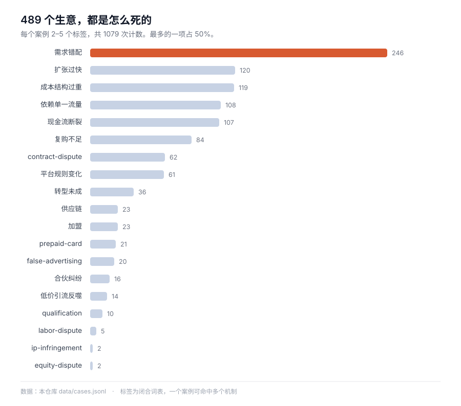

# 스타트업 사례 아틀라스

[中文](README.md) · [English](README.en.md) · [日本語](README.ja.md) · **한국어** · [Español](README.es.md)

    

**499개의 사업, 모두 장부가 붙어 있습니다. 얼마를 들였고, 얼마를 벌었고, 어느 대목에서 돈이 끊겼는지.**

그중 **246건(59%)이 같은 이유로 끝났습니다**——아무도 원하지 않는 것을 만들고, 아무도 원하지 않는다는 사실을 확인하는 데 돈을 다 쓴 경우입니다.

[실패 메커니즘별로 보기](index/by-mechanism.md) · [업종별](index/by-industry.md) · [지역별](index/by-region.md) · [데이터 받기](data/cases.jsonl) · [모델에 먹이기](llms.txt)



> **사례 본문은 중국어입니다.** 스키마·색인·데이터 파일·이 README는 한국어지만, 499편의 본문은 중국어로 쓰여 있습니다. 구조화된 중국어 사업 사례는 희귀하고, 이 아틀라스가 메우는 빈틈이 바로 그 지점입니다.

---

## 30초 요약

| 하려는 일 | 갈 곳 |
| --- | --- |
| 일단 하나 읽기 | [`index/by-mechanism.md`](index/by-mechanism.md)——"프랜차이즈 함정"이나 "현금흐름 단절"부터 |
| 특정 기준으로 찾기 | [업종](index/by-industry.md) · [결말](index/by-outcome.md) · [지역](index/by-region.md) · [연도](index/by-year.md) |
| 데이터가 필요할 때 | [`data/cases.jsonl`](data/cases.jsonl)——499행, 한 줄에 사례 하나, 전체 필드 |
| 모델에 넣을 때 | 먼저 [`llms.txt`](llms.txt)(1.3 KB), 컨텍스트가 충분하면 [`llms-full.txt`](llms-full.txt)(1.7 MB) |

```bash
git clone https://github.com/Shooang/startup-case-atlas.git
```

색인은 다섯 가지입니다. [업종별](index/by-industry.md)은 요식·소매·이커머스·소프트웨어·하드웨어·서비스, [결말별](index/by-outcome.md)은 실패·매각·전환·진행 중, [실패 메커니즘별](index/by-mechanism.md)은 프랜차이즈 함정·현금흐름 단절·플랫폼 의존·비용 구조, [지역별](index/by-region.md)은 중국·미국·영국·인도 등 31개국, [연도별](index/by-year.md)은 같은 실수가 십 년 동안 어떻게 반복됐는지.

## 사례 하나의 구조

칭다오의 해산물 뷔페. 사장은 집을 팔아 150만 위안을 마련했고, 첫 달 매출은 60~70만 위안, 월말에 계산하니 20만 위안 넘는 적자였습니다. 넉 달 만에 문을 닫았습니다.

```yaml
id: G623
title: 卖房凑150万加盟火锅自助，首月流水70万反而亏20多万，四个月闭店
title_en: Sold his house for 1.5M RMB to join a buffet chain, closed in four months
type: 中文小生意
source: https://cbgc.scol.com.cn/news/7946483
era: 中文·青岛·2025-2026
region: CN
outcome: failure
industry: food-beverage
tags: [franchise, low-price-trap, cashflow-crunch, cost-structure]
key_numbers: 总投入150多万（加盟费十几万＋装修40多万＋备货七八十万）｜首月流水六七十万、净亏20多万｜59.9元引流套餐预售近80万｜4个月闭店、自称损失180多万
```

모든 파일이 같은 골격입니다. **16개 고정 필드 + 본문 세 절.**

- `## 故事正文`——600~900자. 시간 순서로 진행하고 결론을 앞세우지 않습니다
- `## 可用观点`——이 사례가 무엇을 논증하는 데 쓰일 수 있는지, 메커니즘 수준까지 내려서
- `## 事实边界`——어떤 숫자가 당사자 진술이고, 어떤 것이 기자 취재이고, 어떤 것이 추정이며, 무엇을 검증하지 못했는지

세 번째 절은 의도적으로 넣었습니다. 같은 "70만 위안 적자"라도 당사자가 말한 것, 기자가 쓴 것, 법원이 인정한 것은 무게가 전혀 다릅니다. 섞어서 말하는 것은 부정직한 일입니다.

## 수록 내용

| 디렉터리 | 편수 | 내용 | 시기 |
| --- | --- | --- | --- |
| [`cases/01-personal-failure/`](cases/01-personal-failure/) | 4 | 당사자가 직접 쓴 실패 기록 | 2015–2024 |
| [`cases/02-founder-postmortems/`](cases/02-founder-postmortems/) | 25 | 창업자 장문 회고, B2B·개발 도구 중심 | 2006–2016 |
| [`cases/03-failory/`](cases/03-failory/) | 129 | 20여 개국 실패 스타트업 인터뷰 | 2020–2023 |
| [`cases/04-indie-hacker/`](cases/04-indie-hacker/) | 156 | 1인 또는 소규모 팀의 유료 제품 | 2019–2026 |
| [`cases/05-china-interviews/`](cases/05-china-interviews/) | 69 | 중국 실물 사업: 요식, 프랜차이즈, 소규모 점포, 서비스 | 2018–2026 |
| [`cases/06-starter-story/`](cases/06-starter-story/) | 36 | 월 매출·초기 비용·준비 기간이 붙은 소규모 사업 | 2019–2024 |
| [`cases/07-judgments/`](cases/07-judgments/) | 80 | 판결: 가맹·동업 해체·대가 도박·미지급 대금·경업 금지·상표·명의 주식·선불카드·공사 대금·중고차·인테리어·라이브커머스·파견 노동·의료 미용·반려동물·운전학원·결혼 중매·치아 교정·대출 중개·퍼스널 트레이닝·산후 케어·여행·반려동물 진료·반려동물 호텔·임대 주택 포름알데히드·인테리어 자재·차량 검사·불법 채권 추심·가사 중개 | 2016–2026 |
| [`legacy/articles/`](legacy/articles/) | 95 | 초기 중국어 웹 아티클 아카이브, 원링크 다수 소실 | 2000–2012 |

**합계:** 499개 사례 · 본문 약 70.7만 자 · 아카이브 95편 · 31개 국가·지역 · 13개 업종 · 5가지 결말 · 19가지 실패 메커니즘.

## 프레임 카드: 사례 뒤에 있는 판단 도구

사례는 '무슨 일이 있었는지'를 알려주고, 프레임은 '다음에 같은 일이 생기면 어떻게 판단할지'를 알려줍니다. **234장, 43권의 책과 강의에서 뽑았습니다.**

각 카드는 바로 읽을 수 있는 첫 문장, 프레임의 내용, 이것으로 판단할 수 있는 3~4가지, 마지막으로 **출처와 한계** — 이 방법이 통하지 않는 조건 — 로 구성됩니다. 카드 본문은 중국어이며, 색인의 `book` 필드도 중국어 제목으로 표기됩니다.

| 책 / 강의 | 장수 | 무엇을 판단할 수 있나 |
| --- | --- | --- |
| 商业思维案例笔记（비즈니스 사고 사례 노트）· 차오슝펑 | 32 | 가치 창조의 네 가지 자, 비용은 물리적 한계까지 쪼개기, 비틀기란 상대가 내준 구간을 받는 것 |
| Winning · 잭 웰치 | 10 | 활력 곡선의 엄격한 전제와 대가, 예산의 두 가지 오류, 인수의 일곱 함정 |
| Lean Business Thinking（精益商业思维）· 청하오 | 10 | 진짜 수요의 세 가지 높은 문턱, 이틀에 검증할 일에 두 달 쓰지 않기, 고객 유치 길은 세 개뿐 |
| The Long Tail · 크리스 앤더슨 | 9 | 롱테일이 성립하려면 세 가지 비용이 동시에 내려가야, 8:2 법칙은 대개 거꾸로 읽힌다, 98%의 상품은 매분기 누군가 산다 |
| The Hard Thing About Hard Things · 벤 호로위츠 | 8 | 감원은 한 번에 끝낸다, 나쁜 소식은 전부 말한다, 회사를 팔지 말지는 두 가지 질문으로만 |
| Zero to One · 피터 틸 | 8 | 독점의 네 가지 특징, 비밀이 없으면 0→1도 없다, 영업은 부속품이 아니다 |
| The PayPal Wars · 에릭 잭슨 | 8 | 보조금이 사는 것은 네트워크 밀도, 남의 플랫폼에서는 남이 규칙을 바꾼다, 사기 손실은 예산에 넣어둔 연구비 |
| Harvard Business Review 2020년 12호 | 8 | 데이터는 저절로 해자가 되지 않는다, 성공의 정의를 안 쓰면 성장이 대신 정의한다, A/B 테스트의 세 함정, 할인은 가격결정권을 채널에 넘기는 일 |
| 钱从哪里来（돈은 어디서 오는가）· 샹수아이 | 7 | 커리어는 눈덩이형과 바위 미는형으로 나뉜다, 도시가 수입의 하한과 상한을 정한다 |
| 跟着高手学复盘（고수의 복기에서 배우다）· 장펑 | 7 | 복기에서 부딪히면 그 사람의 두려움부터 받는다, 솔직함은 제도 설계의 산물, 누구를 불러 모으는가가 무엇을 묻는가보다 결과를 좌우한다 |
| The Psychology of Money · 모건 하우절 | 6 | 행운은 위험과 같은 모양, 복리는 수십 년 동안 보이지 않는다, 저축률이 수익률보다 통제 가능하다 |
| Poor Charlie's Almanack · 찰리 멍거 | 6 | 망치만 든 사람 눈엔 모두가 못으로 보인다, 거꾸로 생각하기, 능력권의 경계가 크기보다 중요하다 |
| Build · 토니 파델 | 6 | 실패는 다시 시도할 수 있는 크기로, 제품은 먼저 하나의 이야기로 말할 수 있어야, 데이터와 의견은 단계를 나눈다, 느리게 뽑고 빨리 자른다 |
| A Dog Called Money（小狗钱钱）· 보도 셰퍼 | 5 | 수익률보다 앞서 거위를 키운다, 72시간 법칙, 빚은 가진 것 전부를 쏟아붓는 게 아니다 |
| 定投十年财务自由（적립식 10년 재정자유）· 银行螺丝钉 | 5 | 적립식이 버는 것은 '싸게 사는 것', 스마일 곡선의 하락 구간, 익절 규칙은 미리 못 박는다 |
| The Almanack of Naval Ravikant · 나발 라비칸트 | 5 | 고유의 전문성, 세 가지 레버리지, 시간을 빌려주지 않는다, 복리는 긴 게임에만 |
| 房价的逻辑（집값의 논리）· 쉬위안 | 5 | 주택가격소득비가 높다고 버블은 아니다, 도시→입지→집 순서 |
| The Intelligent Investor · 벤저민 그레이엄 | 5 | 미스터 마켓의 호가는 감정, 안전마진, 방어형과 공격형의 차이 |
| The Four · 스콧 갤러웨이 | 5 | T 알고리즘에서 자본 가격을 다시 매기는 변수는 '이야기'뿐, 아마존은 이익으로 규모를 산다, 애플이 청구하는 것은 지불 의사 |
| Attention Factory（字节跳动）· 매튜 브레넌 | 5 | 알고리즘이 대체한 것은 편집자의 판단, 콜드스타트는 공급부터 채우는 것, 해자는 양면 잠금에 있다 |
| 硅谷之谜（실리콘밸리의 수수께끼）· 우쥔 | 5 | 제도가 인재의 이동을 결정한다, 파산은 다음 펀딩의 이력이 된다, 예측 가능한 시스템과 불가능한 시스템은 다른 방법으로 |
| Team of Teams · 스탠리 맥크리스털 | 5 | 얽힌 환경에서 예측형 관리는 반드시 실패한다, 우물은 평가제도가 만든다, 임파워먼트는 결정권·정보·역량을 동시에 내린다 |
| An Introduction to General Systems Thinking · 제럴드 와인버그 | 5 | 규모가 두 배면 계산량은 네 배, 기계론은 결합이 약할 때만 유효, 어디서 자르느냐가 무엇이 보이느냐를 정한다 |
| The Fifth Discipline · 피터 센게 | 5 | 다섯 규율은 한 세트, 일곱 가지 학습 장애, 고리를 그려야 지렛대가 보인다, 비전은 팽팽한 장력 |
| Letters from Silicon Valley（吴军硅谷来信）· 우쥔 | 5 | 아끼게 하는 장사와 쓰게 하는 장사는 다른 사업, 선택지를 잘라낸다, 비용을 잘못 놓으면 일이 안 된다, 자본의 층위가 실패 허용도를 정한다 |
| Five-Minute Business School, Practicum（刘润5分钟商学院实战篇）· 류룬 | 5 | 모든 상품이 돈을 벌 필요는 없지만 역할은 있어야, 추천에 수수료를 붙이면 추천이 죽는다, 커미션 비율이 정하는 것은 체감의 배수 |
| Rich Habits · 토머스 콜리 | 4 | 습관이 결과에 앞선다, 77% 대 23%의 격차, 바꾸는 것은 의지가 아니라 계기 |
| 好好赚钱（제대로 돈 벌기）· 젠치 | 4 | 돈은 넷으로 나눈다, 비상금은 최악의 순간에 자산을 팔지 않게 한다, 보험이 사는 것은 꼬리 리스크 |
| What They Don't Teach You at Harvard Business School · 마크 매코맥 | 4 | 가격을 말하기 전에 구매자를 확인한다, 협상의 본체는 대안, 무료 노동은 입장권을 산다 |
| One Thousand and One Nights at NetEase（网易一千零一夜）· 넷이즈 항저우 PMO | 4 | 결정을 바꿀 수 있는 프로세스만 남긴다, 권한이 없을 때는 자리 자체가 권한, 제품 단계가 바뀌면 관리도 바꾼다 |
| The Intelligence Era（智能时代）· 우쥔 | 4 | 빅데이터의 문턱은 전수와 상관성, 기계가 대체하는 것은 데이터화 가능한 판단, 혁명은 먼저 중간층을 비운다, 데이터 소유권은 만든 사람에게 없다 |
| Profit from the Positive（这样带出高估值团队）· 그린버그 & 메이민 | 3 | 회의 비용은 인원×시간, 리더의 감정은 전염된다, 행동을 바꾸지 못하는 평가는 안 하는 만 못하다 |
| 三步打造高绩效团队（3단계 고성과 팀）· 무사 외 | 3 | 팀 규칙은 대화로 만든다, 가상 팀은 신뢰로 지불한다, 스타트업 문화는 어차피 자란다 |
| 领导力的精进（리더십의 정진）· 바이햄 & 웰린스 | 3 | 리더는 영웅이 아니라 촉매다, 5단계 대화 로드맵, 사람이 떠나는 곳은 직속 리더 |
| 33 Personal Finance Lessons Before 35（35岁前要上的33堂理财课）· 쩡즈야오 | 3 | 월급날의 순서, 가계부는 그 20%를 자르기 위한 것, 서른 전의 배분이 선택권을 정한다 |
| Managing in the 21st Century · 피터 드러커 | 3 | 일곱 가지 낡은 관리 가정은 모두 실패, 전략의 다섯 가지 필연, 가처분소득의 비율 |
| Free · 크리스 앤더슨 | 2 | 네 가지 보조 구조, 5% 법칙 |
| Xiaomi Startup Notes · 레이쥔 | 2 | 일곱 글자 결의 핵심은 효율과 신뢰, '뭐든 할 수 있다'는 '뭘 할지 모른다'와 같다 |
| The New Leader's 100-Day Action Plan · 브래트 외 | 1 | 첫 백 일은 질문을, 구조 변경은 나중에 |
| Be the Boss Everyone Wants to Work For · 윌리엄 젠트리 | 1 | 승진이 가장 먼저 빼앗는 것은 동료라는 신분 |
| 宽客人生（퀀트의人生）· 에마뉘엘 더먼 | 1 | 금융 모델은 사고실험이지 진리가 아니다 |
| 查理·芒格的智慧（투자의 그리드 이론）· 로버트 해그스트롬 | 1 | 유효한 전략은 참여자가 늘면서 스스로 실패한다 |
| 街头智慧（스트리트 스마트）· 짐 로저스 | 1 | 높은 가격의 해독제는 높은 가격, 가격 통제는 부족을 낳는다 |

[책별](index/frameworks-by-book.md) · [영역별](index/frameworks-by-doctrine.md) · [첫 문장 모음](index/frameworks-hooks.md) · [카드 규격](docs/framework-schema.md)

## 활용 방법

**원고를 쓸 때.** 사례 하나가 곧 한 편의 골격입니다. 숫자는 이미 있고, 전환점도 이미 있고, "이걸 누구에게 보여줄지"는 `angles`에 적혀 있습니다. 메커니즘으로 걸러내면 같은 유형의 사례 열 개를 나란히 놓고 비교할 수 있습니다.

**사업을 판단할 때.** 프랜차이즈 훠궈가 정말 돈이 되는지 알고 싶다면 칭다오·청두·쿤산 표본이 있습니다. 크리에이터용 도구가 왜 잘 죽는지 알고 싶다면 실패 인터뷰 129편이 있습니다. 같은 메커니즘이 업종을 넘어 반복된다는 규칙성—이것이 단일 사례보다 쓸모 있습니다.

**모델에 먹일 때.** 중국어 사업 사례는 롱테일 코퍼스가 극도로 얇습니다. 특히 구체적 장부가 있는 소규모 사업은 거의 없습니다. 이 라이브러리는 기계를 위해 만들어졌습니다. 필드는 닫혀 있고, 출처는 추적 가능하며, 각 파일은 자기완결적입니다. 청크로 잘라도 어느 조각이든 말이 됩니다.

## 왜 만들었나

창업에 관한 글은 대개 두 가지 결함을 갖습니다. 성공담은 숫자를 지우고, 실패담은 원인을 "경영 부진" 네 글자로 압축합니다.

이 아틀라스는 그 반대를 겨냥했습니다. 499개의 구체적인 사업을 하나씩 기록합니다——**얼마를 들였고, 얼마를 벌었고, 돈이 어디로 사라졌고, 어느 한 수에서 무너졌는지**.

다른 점은 두 가지입니다.

**보통은 기록되지 않는 사업이 들어 있습니다.** 10제곱미터 쌀국수집, 노점, 첫 달 매출 70만 위안인데 20만 위안 넘게 손해 본 프랜차이즈 훠궈. 중국 영세 사업의 경제는 업계 평균이 아니라 임대료와 매입가 수준으로 남아 있습니다.

**숫자의 출처를 적었습니다.** 논쟁이 있는 숫자는 논쟁 자체도 함께 적었습니다.

## 스키마

16개 필드의 정의는 [`docs/schema.md`](docs/schema.md)에 있습니다. 요점:

| 필드 | 타입 | 설명 |
| --- | --- | --- |
| `id` | string | `G001`–`G736`, 빈 번호는 예약 구간 |
| `title` | string | 중국어 원제. 사실을 진술하고 핵심 숫자를 포함 |
| `title_en` | string | 영어 제목, 8–14단어 |
| `type` | string | 출처 유형: 자술, 인터뷰, 보도, 데이터베이스 |
| `source` | url | 원문 또는 원 인터뷰 링크 |
| `era` | string | `언어·국가·연도`, 출처 표기를 따름 |
| `source_language` | enum | `zh` \| `en` \| `unknown` |
| `region` | enum | 국가 코드. 모르면 `unknown`, **추측하지 않음** |
| `year` | int | 사건 시작 연도 |
| `outcome` | enum | `failure` \| `success` \| `exit` \| `pivoted` \| `ongoing` |
| `industry` | enum | 13개 값. [`docs/taxonomy.md`](docs/taxonomy.md) 참조 |
| `tags` | list | 19개 폐쇄 어휘에서 2–5개 실패 메커니즘 |
| `key_numbers` | string | 이야기를 떠받치는 숫자, `｜`로 구분 |
| `timeline` | string | 시작 → 전환 → 결말, 각 한 문장 |
| `causal_chain` | string | 핵심 인과 하나. 이유 나열이 아님 |
| `angles` | string | 이 사례가 무엇을 논증하는 데 쓰이는지 |
| `status` | string | 편집 상태. 데이터 자체는 아님 |

## 출처와 라이선스

이것은 **2차적 저작물이며 미러 사이트가 아닙니다**. 다른 사람의 기사를 복사해 붙인 글은 한 편도 없습니다. 모두 공개된 보도를 바탕으로 다시 쓴 중국어 기술이며, 원문 링크가 파일 안에 있습니다.

- **사례 본문**(499편): [CC BY-SA 4.0](LICENSE). 전재·변형 가능, 출처 표시 필요, 파생물도 동일 라이선스.
- **그중 4편은 [`byoungd/up`](https://github.com/byoungd/up)에서 유래**: 해당 프로젝트 본문이 **CC BY-NC 4.0**이므로 이 4편은 **상업적 이용 불가**. 자세한 내용은 [`ATTRIBUTIONS.md`](ATTRIBUTIONS.md).
- **아카이브 아티클**(`legacy/`): 저작권은 원저자와 원 발행처에 있습니다. 연구와 색인 목적으로만 수록했으며 통지-삭제 절차를 따릅니다. [`DISCLAIMER.md`](DISCLAIMER.md) 참조.

업스트림 라이선스는 [`third-party/`](third-party/)에 원문 그대로 보존했습니다. 각 출처의 크레딧, 수집 날짜, 무엇을 사용했는지는 [`ATTRIBUTIONS.md`](ATTRIBUTIONS.md)에 나열했습니다.

**권리자**께서 삭제를 원하시면 `takedown` 태그를 붙여 이슈를 열어 주십시오. 이견 없이 삭제합니다.

## 참여

**추가보다 정정이 더 값집니다.** 여기 숫자가 원전과 모순된다면 그것은 버그입니다. 링크를 붙여 알려 주십시오. [`docs/contributing.md`](docs/contributing.md) 참조.

새 사례는 세 조건을 넘으면 환영합니다. 열리는 원링크, 구체적 숫자 두 개 이상, 실패 메커니즘이 "경영 부진"보다 구체적일 것. 출처 없이 추측으로 쓴 것은 이야기가 아무리 좋아도 받지 않습니다.

## 덧붙여

투자 조언이 아니고, 누가 더 똑똑한지 줄 세우는 것도 아닙니다. 여기 실렸다는 것은 그 사업이 기록됐다는 뜻이지 평가받았다는 뜻이 아닙니다. 이 가운데 어떤 실패는 대부분의 판단을 옳게 했지만 때를 맞추지 못한 사람들입니다.

---

이 라이브러리가 자료를 찾는 며칠을 아껴 주었다면, **star가 가장 직접적인 보답**입니다. 다음에 같은 자료를 찾는 사람이 여기에 더 쉽게 닿게도 합니다.

*공개 데이터셋으로 유지합니다. 연구나 제품에 쓸 때 링크를 걸어 주시면 반갑지만 필수는 아닙니다.*
