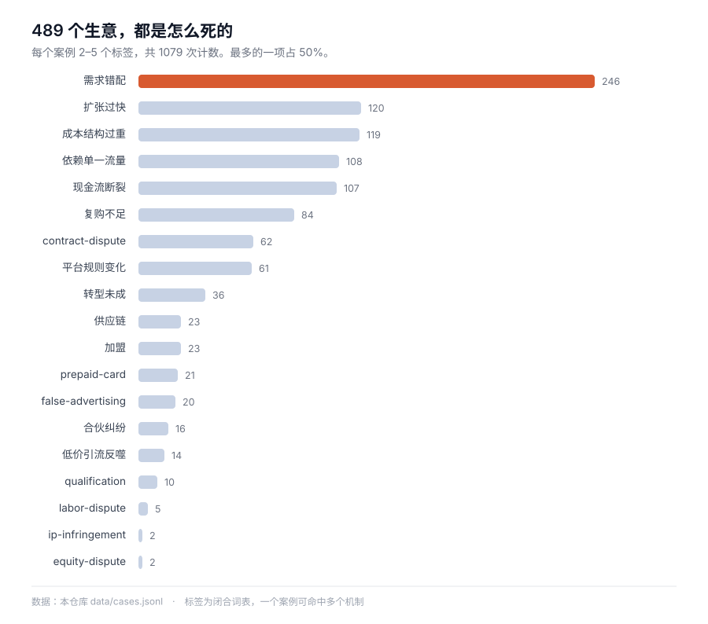

# 创业案例图谱 Startup Case Atlas

中文 · [English](README.en.md) · [日本語](README.ja.md) · [한국어](README.ko.md) · [Español](README.es.md)

   

**419 个生意，每一个都记了账：花了多少，挣了多少，钱在哪一步没的。**

其中 **246 个（59%）死于同一件事**——做了一件没人要的东西，然后在发现这件事的过程中把钱用完了。

**另有 67 张框架卡**——从 11 本商业书里提出来的判断工具。案例是证据，框架是判断。

[按失败机制浏览](index/by-mechanism.md) · [按行业](index/by-industry.md) · [按地区](index/by-region.md) · [拿数据](data/cases.jsonl) · [喂给模型](llms.txt)



---

## 30 秒上手

| 你想干什么 | 去哪儿 |
| --- | --- |
| 随便读一个 | [`index/by-mechanism.md`](index/by-mechanism.md)——从"加盟陷阱"或"现金流断裂"开始 |
| 找特定角度 | [按行业](index/by-industry.md) · [按结局](index/by-outcome.md) · [按地区](index/by-region.md) · [按年份](index/by-year.md) |
| 拿数据 | [`data/cases.jsonl`](data/cases.jsonl)——419 行，每行一个案例，字段齐全 |
| 喂给模型 | 先读 [`llms.txt`](llms.txt)（1.3 KB），上下文够再上 [`llms-full.txt`](llms-full.txt)（1.7 MB） |
| 找一个判断工具 | [按书浏览框架卡](index/frameworks-by-book.md)——67 张，从 11 本书里提的 |

```bash
git clone https://github.com/Shooang/startup-case-atlas.git
```

## 一个案例长什么样

这是其中一个：青岛一家海鲜自助，卖房凑了 150 万，首月流水六七十万，月底算账净亏二十多万，第四个月闭店。

```yaml
id: G623
title: 卖房凑150万加盟火锅自助，首月流水70万反而亏20多万，四个月闭店
type: 中文小生意
source: https://cbgc.scol.com.cn/news/7946483
era: 中文·青岛·2025-2026
region: CN
outcome: failure
industry: food-beverage
tags: [franchise, low-price-trap, cashflow-crunch, cost-structure]
key_numbers: 总投入150多万（加盟费十几万＋装修40多万＋备货七八十万）｜首月流水六七十万、净亏20多万｜59.9元引流套餐预售近80万｜4个月闭店、自称损失180多万
```

每个文件都是这个骨架：**16 个固定字段 + 三段正文**。

- `## 故事正文`——600 到 900 字，按时间走，不跳结论
- `## 可用观点`——这个案例能拿来论证什么，落在机制上
- `## 事实边界`——哪些数字是当事人自述、哪些是记者采访、哪些是估算、哪些没法核实

第三段是刻意加的。同一个"亏了 70 万"，当事人说的、媒体写的、法院认定的，分量完全不同，混在一起讲就是耍流氓。

## 收录了什么

| 目录 | 篇数 | 内容 | 年代 |
| --- | --- | --- | --- |
| [`cases/01-personal-failure/`](cases/01-personal-failure/) | 4 | 当事人自己写的失败自述 | 2015–2024 |
| [`cases/02-founder-postmortems/`](cases/02-founder-postmortems/) | 25 | 创始人长文复盘，多为 B2B 与开发工具 | 2006–2016 |
| [`cases/03-failory/`](cases/03-failory/) | 129 | 二十多个国家的失败创业访谈 | 2020–2023 |
| [`cases/04-indie-hacker/`](cases/04-indie-hacker/) | 156 | 单人或小团队做付费产品 | 2019–2026 |
| [`cases/05-china-interviews/`](cases/05-china-interviews/) | 69 | 中国实体生意：餐饮、加盟、小店、服务 | 2018–2026 |
| [`cases/06-starter-story/`](cases/06-starter-story/) | 36 | 带月收入、启动成本、启动耗时的小生意 | 2019–2024 |
| [`legacy/articles/`](legacy/articles/) | 95 | 早期中文网络创业故事存档，多数原链接已失效 | 2000–2012 |

**合计：** 419 个案例 · 约 57.6 万字案例正文 · 95 篇存档 · 31 个国家和地区 · 13 个行业 · 5 种结局 · 12 类失败机制。

## 框架卡：案例背后的判断工具

案例告诉你一件事是怎么发生的，框架告诉你下次遇到同类的事该怎么判断。**67 张卡，来自 11 本书。**

一张卡长这样：一个能直接念的开场，一段讲清这个框架到底在说什么，三到四条能拿来判断什么，最后是**出处与边界**——写明这方法在什么情况下不管用。

| 书 | 张数 | 能拿来判断什么 |
| --- | --- | --- |
| 赢 · 韦尔奇 | 10 | 活力曲线有硬前提也有硬代价、预算的两种错法、并购七个陷阱 |
| 精益商业思维 · 程浩 | 10 | 真刚需的三个极大、两天能验证的事别花两个月、获客只有三条路 |
| 长尾理论 · 安德森 | 9 | 长尾成立要三种成本同时下降、八二法则被读反了、98% 的商品每季都有人买 |
| 创业维艰 · 霍洛维茨 | 8 | 裁员一次做完、坏消息要讲全、该不该卖公司只看两个问题 |
| 从0到1 · 蒂尔 | 8 | 垄断的四个特征、没有秘密就没有从0到1、销售不是附属 |
| 支付战争 · 杰克逊 | 8 | 补贴买的是网络密度、在别人平台上规则由别人改、诈骗损失是预算内的研发费 |
| 钱从哪里来 · 香帅 | 7 | 职业分滚雪球和推石头、城市是收入的下限和上限 |
| 21世纪的管理挑战 · 德鲁克 | 3 | 七条旧管理假设全失效、战略的五个必然、可支配收入的比例 |
| 免费：商业的未来 · 安德森 | 2 | 四种补贴结构、5% 定律 |
| 小米创业思考 · 雷军 | 2 | 七字诀的核心是效率与信任、看似什么都能做就是什么都不知道 |

[按书浏览](index/frameworks-by-book.md) · [按领域](index/frameworks-by-doctrine.md) · [全部开场句](index/frameworks-hooks.md) · [卡片规范](docs/framework-schema.md)

框架卡和案例是两种东西，别混着用：**案例是证据，框架是判断**。一张卡配两个同类案例，就能撑起一期内容。比如 F004 讲"免费是补贴结构"，接上 G623 那个卖房开店、59.9 元引流券卖亏的青岛店主——一个 2009 年的美国理论和一家 2025 年的中国小店，说的是同一个机制。

## 你可以拿它做什么

**写东西。** 一个案例就是一期的骨架：数字是现成的，转折是现成的，连"这事儿该给谁看"都写在 `angles` 里。按机制筛一遍，能找到十个同类案例做横向对比。

**判断一个生意。** 想知道加盟火锅到底赚不赚钱，这里有青岛、成都、昆山的样本；想知道给创作者做工具为什么容易死，这里有 129 个失败访谈可以对照。同一个机制在不同行业重复出现，这个规律比单个案例有用。

**喂给 AI。** 中文商业案例的长尾语料极缺，尤其是带具体账目的中小生意。这个库的结构是给机器准备的：字段闭合、来源可溯、每个文件自包含，切块之后每一块都还讲得通。

## 为什么做这个

讲创业的东西，大多两个毛病：成功的故事把数字抹掉，失败的故事把原因缩成"经营不善"四个字。

这个库想做的正相反：拿 419 个具体的生意，一个一个记下来——**它花了多少钱，挣了多少钱，钱到底去哪了，是哪一步把它弄塌的**。

有两件事让它跟别的不太一样：

**它记了那些通常没人记的生意。** 十平米的米线店、路边摊、首月流水七十万却亏二十多万的加盟火锅。中国小生意的经济账，在这里具体到房租和进货价，不是"行业平均"。

**它标了每个数字的来路。** 有争议的地方，争议本身也写进去。

## 字段规范

16 个字段，完整定义在 [`docs/schema.md`](docs/schema.md)。简版：

| 字段 | 类型 | 说明 |
| --- | --- | --- |
| `id` | string | `G001`–`G736`，空号是预留段 |
| `title` | string | 中文原标题，陈述事实，带关键数字 |
| `title_en` | string | 英文标题，8–14 词 |
| `type` | string | 来源类型：自述、访谈、报道、数据库 |
| `source` | url | 原文或原始访谈链接 |
| `era` | string | `语言·国别·年份`，按来源所写 |
| `source_language` | enum | `zh` \| `en` \| `unknown` |
| `region` | enum | 国家代码，未知写 `unknown`，**从不猜** |
| `year` | int | 事件起始年份 |
| `outcome` | enum | `failure` \| `success` \| `exit` \| `pivoted` \| `ongoing` |
| `industry` | enum | 13 个值，见 [`docs/taxonomy.md`](docs/taxonomy.md) |
| `tags` | list | 2–5 个失败机制，取自 12 个闭合词 |
| `key_numbers` | string | 撑起这个故事的数字，用 `｜` 分隔 |
| `timeline` | string | 起点 → 转折 → 结局，各一句 |
| `causal_chain` | string | 一条主线因果，不是理由罗列 |
| `angles` | string | 这个案例能拿来论证什么 |
| `status` | string | 编务状态，不属于数据本身 |

## 来源与许可

这是一个**衍生作品，不是镜像站**。这里没有一篇是把别人的文章复制粘贴过来的——每个案例都是基于已公开发表的内容重新写的中文记述，原文链接就在文件里。

- **案例正文**（419 篇）：[CC BY-SA 4.0](LICENSE)。可转载、可改编，需署名，衍生作品沿用同一许可。
- **其中 4 篇源自 [`byoungd/up`](https://github.com/byoungd/up)**：该项目正文为 **CC BY-NC 4.0**，这 4 篇同样**不可商用**。详见 [`ATTRIBUTIONS.md`](ATTRIBUTIONS.md)。
- **存档文章**（`legacy/`）：版权归原作者与原发布方所有，仅为研究与索引目的收录，采用通知—删除机制。详见 [`DISCLAIMER.md`](DISCLAIMER.md)。

上游许可证原样保留在 [`third-party/`](third-party/)。每个来源的署名、抓取日期、具体用了什么，都列在 [`ATTRIBUTIONS.md`](ATTRIBUTIONS.md)。

**如果你是权利人**，希望某篇内容下架，开一个 issue 标 `takedown`，我们不争辩，直接删。

## 参与

**纠错比新增更值钱。** 如果这里的某个数字与原始出处矛盾，那是个 bug，请附上链接报过来。见 [`docs/contributing.md`](docs/contributing.md)。

新增案例欢迎，但要过三条：有能打开的原始链接、至少两个具体数字、失败机制具体到不是一个"经营不善"就能概括。没出处、靠推测写的，故事再好也退。

## 一点说明

这不是投资建议，也不是在给谁排聪明与否。一个案例出现在这里，只代表这门生意被记录过，不代表它被评判过。这里有些失败者，是在大部分事情上都做对了，只是没赶上时间。

---

如果这个库替你省下几天找资料的时间，**点个 star 是最直接的回报**——它也让下一个找这类资料的人更容易找到这里。

*作为公开数据集维护。用于研究或产品时，附个回链会很高兴，但不必需。*
